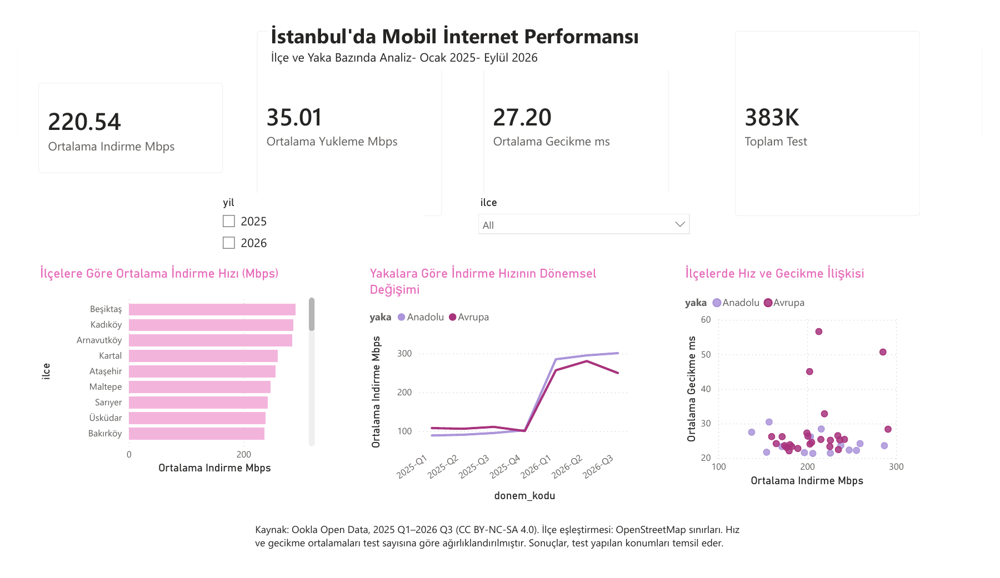

# İstanbul’da Mobil İnternet Performansı ve Semt Sinyal

**[Canlı uygulamayı aç — Semt Sinyal](https://semt-sinyal.vercel.app/)** · [HTML kaynak kodu](semt-sinyal/index.html) · [Uygulama dokümantasyonu](semt-sinyal/README.md)

İstanbul’un iki ilçesini seçerek indirme/yükleme hızlarını, gecikmeyi, test sayılarını ve 2025 nüfuslarını karşılaştırın. Mobil cihazlarda desteklenen tarayıcılardan ana ekrana eklenebilir.

Telefon kamerasıyla QR kodunu okutun veya [QR görselini indirin](assets/semt-sinyal-qr.png). Giriş gerektirmez.

[PDF raporunu görüntüle](istanbul_mobil_internet_analizi.pdf) · [Power BI dosyasını indir](istanbul_mobil_internet_analizi.pbix)

Power BI ile İstanbul’un 39 ilçesinde mobil internet performansının ilçe, yaka ve dönem bazında incelenmesi.

## Kapsam

- Ocak 2025–Eylül 2026: 7 çeyrek, 39 ilçe ve 273 ilçe–dönem kaydı.
- Test sayısına göre ağırlıklı indirme hızı, yükleme hızı ve gecikme.
- İlçe sıralaması, Anadolu–Avrupa yakalarının dönemsel karşılaştırması ve hız–gecikme dağılımı.
- İlçe ve yıl filtreleriyle etkileşimli tek sayfalık rapor.

## Kullanım

`istanbul_mobil_internet_analizi.pbix` dosyasını indirip Microsoft Power BI Desktop ile açın. GitHub PBIX raporunu doğrudan görüntülemez. Yenileme için kaynak CSV dosyasının yolunun kendi bilgisayarınıza göre düzenlenmesi gerekebilir.

## Veri modeli

`Ilceler` ve `donemler` boyutları, `MobilPerformans` tablosuna bire çok ilişkilerle bağlıdır. Boyut tabloları Power Query’de ana tablodan referans alınarak oluşturulmuştur.

## Yöntem ve sınırlar

İlçe eşleştirmesi, konumsal hücre merkezlerinin OpenStreetMap tabanlı ilçe sınırları içinde bulunmasına göre yapılmıştır. Ortalamalar test sayısıyla ağırlıklandırılmıştır. Veriler test yapılan konumları temsil eder; tüm kullanıcıları temsil ettiği varsayılmaz. Veri doğrudan sinyal gücü, baz istasyonu sayısı veya operatör karşılaştırması içermez. 2026 yalnızca ilk üç çeyreği kapsar; yıllık karşılaştırmalarda aynı dönemler seçilmelidir.

## Kaynak ve lisans

- [Speedtest by Ookla Global Fixed and Mobile Network Performance Maps](https://github.com/teamookla/ookla-open-data), 2025 Q1–2026 Q3; erişim 3 Kasım 2026. Veri lisansı: [CC BY-NC-SA 4.0](https://creativecommons.org/licenses/by-nc-sa/4.0/). İlçe bazında özetleme ve birim dönüşümü uygulanmıştır. Ookla verilerinden türetilen içerik aynı lisans koşullarına tabidir.
- Nüfus: TÜİK ADNKS 2025, [İTO Veri İstanbul](https://veriistanbul.ito.org.tr/view/kategori/veri.php?Guid=89c6a94b-181a-46ea-a62a-c404ebfe8272) üzerinden. Nüfus yılı internet döneminden bağımsız olarak 2025’tir.
- [İstanbul ilçe sınırları](https://github.com/sahircansurmeli/istanbul-geojson): © [OpenStreetMap contributors](https://www.openstreetmap.org/copyright), ODbL 1.0.

Bu proje bağımsız bir öğrenci çalışmasıdır.

## Semt Sinyal web uygulaması

İki ilçenin internet sonuçlarını, 2025 nüfuslarını ve açıklamalı karşılaştırmayı telefon görünümünde inceleyen çalışan web prototipi. HTML, CSS, JavaScript ve Python ile hazırlanmıştır. Sunucu tarafındaki salt okunur API mevcut veri setini sunar; BTK bağlantısı veya canlı ölçüm içermez. PWA, ilk başarılı yüklemeden sonra saklanan veriyle çevrimdışı karşılaştırmayı destekler. [Uygulama dosyaları ve çalıştırma yönergeleri](semt-sinyal/README.md).

[Semt Sinyal canlı uygulamasını aç](https://semt-sinyal.vercel.app)
